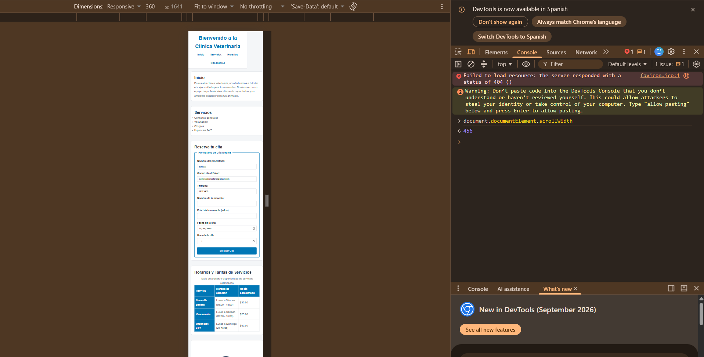
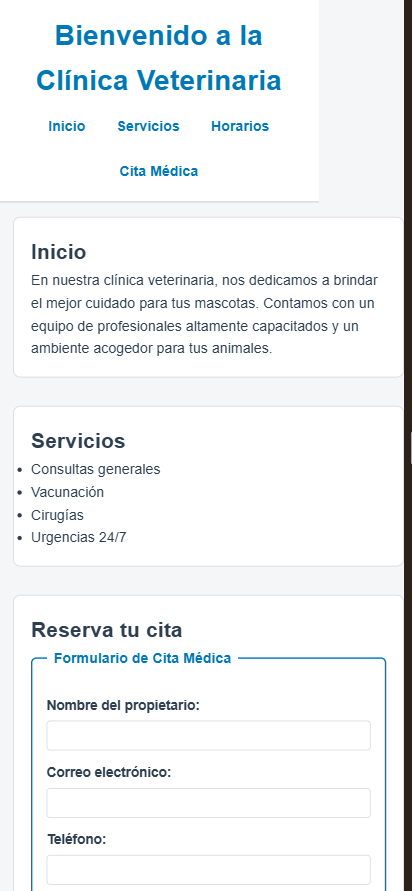
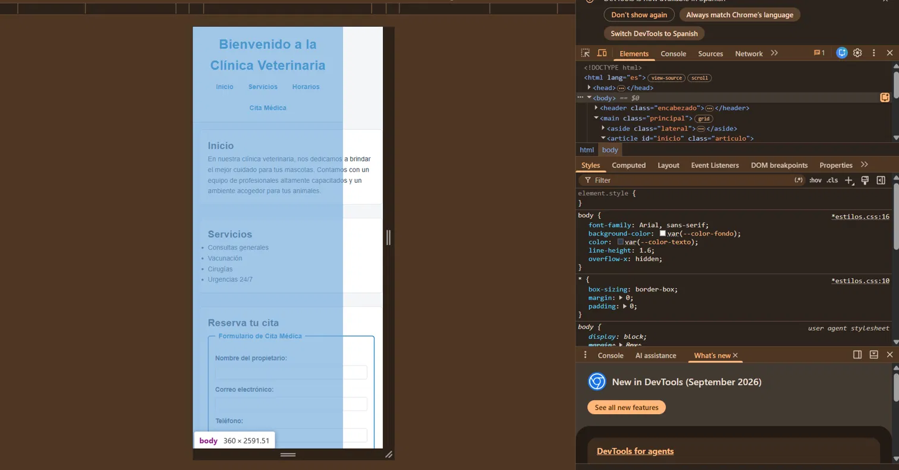
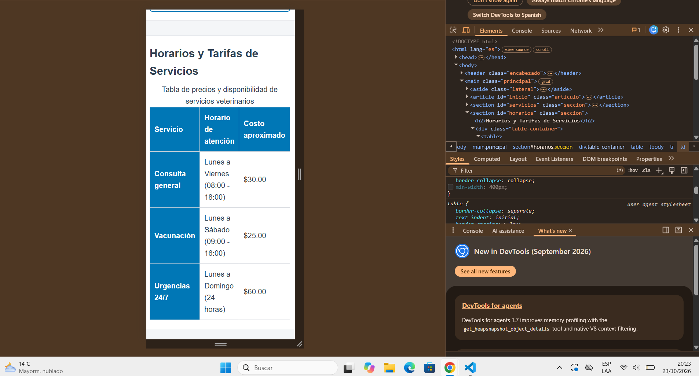
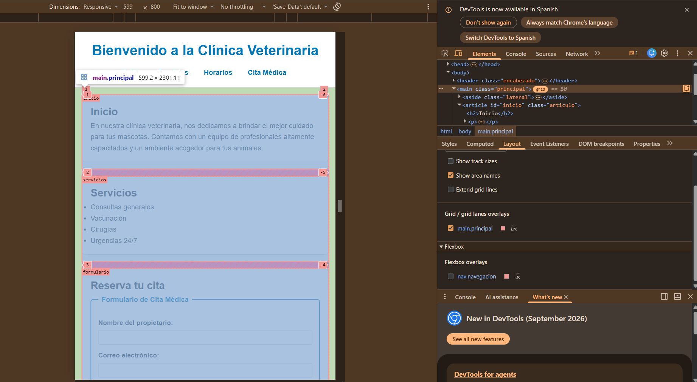
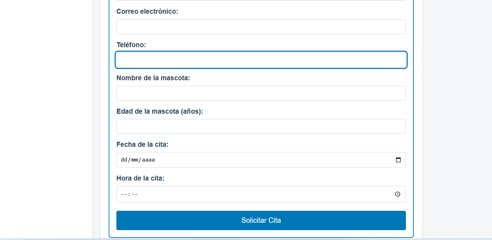
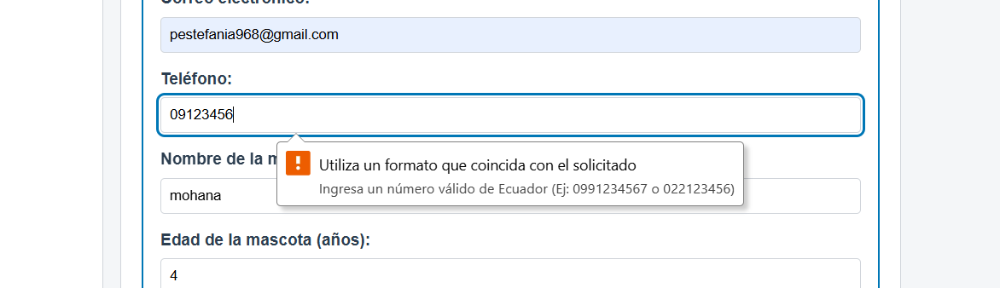
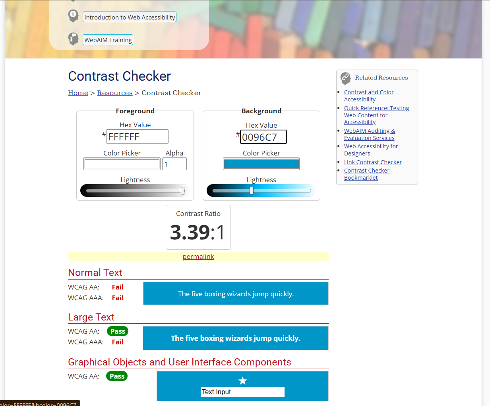
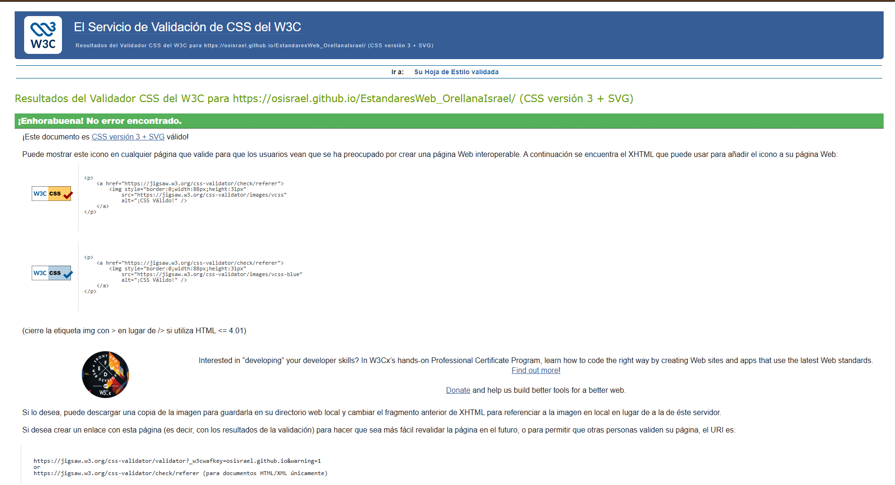
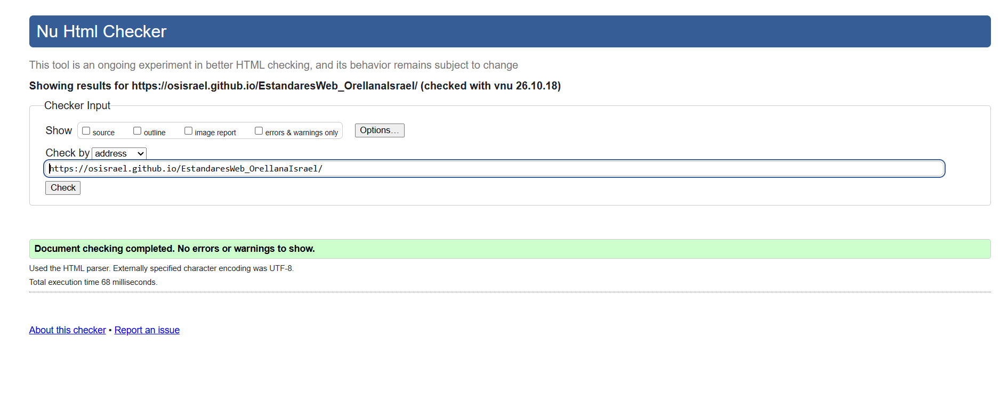

# Informe de auditoría: página del N.º de lista 20

**Auditor:** N.º de lista 21, Denisse Estefanía Paredes Patiño

**Compañero auditado:** N.º de lista 20, Orellana Solano Israel Sebastián

**Página revisada:** https://osisrael.github.io/EstandaresWeb_OrellanaIsrael/

**Repositorio:** https://github.com/OSIsrael/EstandaresWeb_OrellanaIsrael

**Fecha de la sesión:** 23/10/2026

## 1. Ficha del compañero

| N.º de lista | Temática | Campos especiales del formulario | Breakpoint principal | Restricción especial |
|---|---|---|---|---|
| 20 | Clínica veterinaria | Teléfono ecuatoriano validado con pattern | 600 px | Layout principal con `grid-template-areas` que cambia de orden en móvil |

## 2. Qué esperaba encontrar y qué encontré

| Requisito | Qué esperaba encontrar | Qué encontré |
|---|---|---|
| Base 1: estructura semántica | Que tuviera cabecera, menú, contenido principal, secciones con título, una barra lateral y un pie de página, y que los títulos bajaran en orden sin saltarse niveles. | Tiene `header`, `nav`, `main`, `aside` y `footer`. Hay un solo `h1` y los demás títulos son `h2`. Cumple. |
| Base 2: formulario | Cinco campos o más, cada uno con su etiqueta, el tipo de campo adecuado, validación del navegador y `fieldset` con `legend`. | Hay 7 campos y todos tienen `label for`. Usa los tipos texto, correo, teléfono, número, fecha y hora, todos con `required`, y hay un `fieldset` con `legend`. Cumple, menos los detalles de los hallazgos 4, 7 y 8. |
| Base 3: tabla | Que la tabla tuviera `caption`, `thead`, `tbody` y `scope` en los encabezados. | Tiene `caption`, `thead` y `tbody`, con `scope="col"` en las columnas y `scope="row"` en las filas. Cumple. |
| Base 4: layout responsive | Grid para la estructura, Flexbox en un componente y que no hubiera scroll horizontal a 360 px. | Usa Grid en `.principal` y Flexbox en `.navegacion`. Pero a 360 px el contenido es más ancho que la pantalla y `overflow-x: hidden` lo esconde (hallazgo 1). |
| Base 5: variables CSS y contraste | Colores guardados como variables `--color-...` y buen contraste (mínimo 4.5:1). | Las variables están en `:root`. El texto principal y el azul sobre blanco se ven bien, pero fallan el borde de los campos y el botón en hover (hallazgos 5 y 6). |
| Base 6: teclado y foco | Enlace para saltar al contenido, poder recorrer todo con Tab y ver dónde está el foco. | Recorrí la página con Tab. El menú se recorre completo y los campos muestran un contorno azul al recibir el foco. Pero no hay enlace para saltar al contenido (hallazgo 9). |
| Base 7: validadores | Cero errores en el validador de HTML y en el de CSS. | El HTML sale sin errores ni advertencias y el CSS sin errores. Cumple. |
| Base 8: imágenes con alt | Un texto alternativo adecuado en cada imagen. | El logo tiene un `alt` que lo describe ("Logotipo oficial de la clínica veterinaria con huella animal"). Cumple. |
| Ficha: temática | Que el contenido fuera de una clínica veterinaria. | Tiene servicios, horarios, tarifas, historia de la clínica y formulario de cita médica. Cumple. |
| Ficha: teléfono con pattern | Un campo `type="tel"` con un pattern para teléfonos de Ecuador, con etiqueta y ayuda para el usuario. | Existe `#telefono` con `type="tel"` y `pattern="0[2-7]\d{7}\|09\d{8}"`, que cubre fijos y celulares. Probé `09123456` (le falta un dígito) y el navegador lo rechazó. Pero no hay ayuda visible antes de escribir (hallazgo 3). |
| Ficha: breakpoint de 600 px | Una media query principal en 600 px. | Existe `@media (min-width: 600px)` (mobile-first). A 599 px se ve una sola columna. Cumple. |
| Ficha: `grid-template-areas` que cambia de orden en móvil | Áreas reordenadas entre móvil y escritorio, con el orden del HTML coherente con lo que se ve. | Las áreas sí cambian, pero en móvil el orden que se ve no coincide con el del HTML (hallazgo 2). |

## 3. Informe de auditoría

| N.º | Requisito | Ubicación (archivo y línea o selector) | Hallazgo | Norma que incumple | Evidencia | Severidad (alta, media, baja) |
|---|---|---|---|---|---|---|
| 1 | Base 4: layout responsive (360 px) | `estilos.css`, línea 21: `body { overflow-x: hidden }`; línea 152: `.principal` con `grid-template-columns: 1fr`; línea 84: `table { min-width: 400px }` | Al abrir la página a 360 px de ancho, en la consola `document.documentElement.scrollWidth` me dio 456, o sea 96 px más que la pantalla. Las tarjetas se salen por la derecha y el fondo blanco del encabezado termina antes que el contenido. Además, `overflow-x: hidden` en `body` esconde el problema en lugar de resolverlo. Cuando desactivé en DevTools la regla `min-width: 400px` de la tabla, esta se ajustó a la pantalla, así que esa regla contribuye al desborde. | WCAG 2.2, criterio 1.4.10 (Reflow). Requisito base 4 de la guía (sin scroll horizontal en 360 px). | Consola a 360 px: `scrollWidth = 456`.     | Alta |
| 2 | Ficha: `grid-template-areas` que cambia de orden en móvil | `index.html`, línea 21: `<aside>` es el primer hijo de `main`; líneas 42 y 75: `section#horarios` y `section#formulario`. `estilos.css`, líneas 154 a 159 (áreas de móvil) y 173 a 177 (áreas de escritorio) | A 599 px el grid muestra inicio, servicios, formulario, horarios y lateral, pero en el HTML el orden es aside, inicio, servicios, horarios, formulario. Un lector de pantalla leería primero la historia y los horarios antes que el formulario, al revés de lo que se ve en la pantalla. | WCAG 2.2, criterio 1.3.2 (Secuencia significativa). | Inspector de grid a 599 px con los nombres de las áreas; en el panel Elements se ve el `<aside>` como primer hijo de `main`.  | Media |
| 3 | Ficha: teléfono con pattern | `index.html`, línea 88: `input#telefono` | El formato esperado (`0991234567` o `022123456`) solo aparece en el globo de error cuando se escribe un dato inválido. Antes de escribir no hay texto de ayuda visible ni `aria-describedby`, así que el usuario no sabe el formato hasta equivocarse. | WCAG 2.2, criterio 3.3.2 (Etiquetas o instrucciones). | Campo vacío sin ayuda visible y error al escribir `09123456`.   | Baja |
| 4 | Base 2: formulario | `index.html`, líneas 82, 85 y 88: `input#nombre`, `input#email` e `input#telefono` | Los tres campos piden datos del propio usuario y no tienen el atributo `autocomplete` (`name`, `email`, `tel`). | WCAG 2.2, criterio 1.3.5 (Identificar el propósito de la entrada). | Código de los tres `input` en `index.html`, líneas 82, 85 y 88, sin `autocomplete`. | Baja |
| 5 | Base 5: contraste | `estilos.css`, línea 122: `input:not([type="submit"])` con `border: 1px solid var(--color-borde)` | El borde de los campos es `#d1d5db` sobre fondo blanco, y calculé que da cerca de 1.5:1. El límite del campo casi no se distingue y el mínimo para componentes de interfaz es 3:1. | WCAG 2.2, criterio 1.4.11 (Contraste no textual). | Cálculo de contraste de `#d1d5db` sobre `#ffffff`, cerca de 1.5:1. El borde se ve muy claro en la captura.  | Media |
| 6 | Base 5: contraste | `estilos.css`, líneas 138 a 140: `input[type="submit"]:hover` con `background-color: var(--color-secundario)` | Al pasar el mouse, el texto blanco queda sobre `#0096c7` y el contraste es 3.39:1. El texto del botón es de 1 rem y sin negrita, así que cuenta como texto normal y necesita 4.5:1. | WCAG 2.2, criterio 1.4.3 (Contraste mínimo). | WebAIM Contrast Checker: `#ffffff` sobre `#0096c7` da 3.39:1, WCAG AA texto normal: Fail.  | Baja |
| 7 | Base 2: formulario | `index.html`, líneas 81 a 100: todos los campos con `required` | Todos los campos son obligatorios, pero ninguna etiqueta tiene asterisco ni aviso que lo diga. El usuario solo se entera cuando falla el envío. | WCAG 2.2, criterio 3.3.2 (Etiquetas o instrucciones). | Formulario sin ninguna indicación de campos obligatorios.  | Baja |
| 8 | Ficha: coherencia entre formulario y tabla | `index.html`, líneas 97 y 100: `input#fecha` e `input#hora` | `#fecha` no tiene `min`, así que permite elegir fechas pasadas. `#hora` no tiene `min` ni `max`, así que acepta una cita a las 03:00 aunque la tabla de horarios dice de 08:00 a 18:00. | Criterio propio de coherencia entre el formulario y su contenido (no es una norma WCAG). | Código de `#fecha` y `#hora` en `index.html`, líneas 97 y 100, sin `min` ni `max`. | Baja |
| 9 | Base 6: teclado y foco | `index.html`, línea 9: `<body>`, donde debería ir el enlace antes del `<header>` | No existe un enlace para saltar al contenido. Al pulsar Tab, el primer elemento que recibe el foco es "Inicio" del menú y el foco pasa por Servicios, Horarios y Cita Médica antes de llegar al contenido. | WCAG 2.2, criterio 2.4.1 (Evitar bloques) y requisito Base 6 de la guía. | Recorrido con Tab desde el inicio de la página: el primer foco cae en "Inicio", sin ningún enlace antes. | Baja |

## 4. Evidencia de los validadores y del teclado

**Validador CSS (W3C): sin errores**

**Validador HTML (Nu Html Checker): sin errores ni advertencias**

**Foco visible: contorno azul en el campo Teléfono**

**Prueba del patrón del teléfono**

| Valor | Esperado | Resultado |
|---|---|---|
| `09123456` | inválido (le falta un dígito) | Inválido. El navegador mostró "Utiliza un formato que coincida con el solicitado" y el texto del `title` con ejemplos. |

## 5. Sugerencias menores

- `margin-bottom: 1rem` en las tarjetas más `gap: 1rem` en el grid duplica el espacio entre ellas.
- El logo no tiene `width` ni `height`, así que el diseño se puede mover mientras carga.
- El `title` del teléfono ayuda, pero conviene agregar un texto de ayuda visible enlazado con `aria-describedby`.

## 6. Conclusión

En esta auditoría revisé la página de mi compañero Israel Orellana contra los requisitos base y los de su ficha: clínica veterinaria, teléfono ecuatoriano validado con `pattern`, breakpoint de 600 px y `grid-template-areas` que cambia de orden en móvil. Para cada requisito primero escribí qué esperaba encontrar y después lo comprobé en el navegador con DevTools, los validadores del W3C y la navegación con teclado.

Lo que Israel hizo bien es bastante. La estructura semántica está completa, la tabla tiene `caption` y `scope` correctos, el `pattern` del teléfono acepta celulares (`09XXXXXXXX`) y fijos (`0[2-7]XXXXXXX`), el breakpoint está justo en 600 px, el logo tiene un `alt` descriptivo y los dos validadores no dieron errores. También usa variables CSS y los campos muestran el foco con un contorno azul.

Encontré 9 hallazgos. Los dos más importantes son el desborde horizontal a 360 px (hallazgo 1, severidad alta), porque `overflow-x: hidden` esconde el problema en lugar de arreglarlo, y que el orden visual del grid en móvil no coincide con el orden del HTML (hallazgo 2), lo que afectaría a quien use un lector de pantalla. Los demás son de severidad media o baja y tienen que ver con el formulario y el contraste: falta de ayuda visible en el teléfono, poco contraste en el borde de los campos y en el botón en hover, falta de `autocomplete`, de indicación de campos obligatorios y de enlace para saltar al contenido, y la fecha y la hora que no coinciden con los horarios de la tabla.

Mi recomendación es quitar `overflow-x: hidden` y revisar el ancho de la tabla en móvil, reordenar el HTML según el orden de lectura y agregar un texto de ayuda al campo del teléfono. Con esos cambios la página cumpliría los requisitos de la ficha. En general, el trabajo de Israel está bien hecho en lo estructural y solo necesita ajustes de responsive y de accesibilidad. 
## 7. Fuentes

- WCAG 1.3.2, Meaningful Sequence: https://www.w3.org/WAI/WCAG22/Understanding/meaningful-sequence
- WCAG 1.3.5, Identify Input Purpose: https://www.w3.org/WAI/WCAG22/Understanding/identify-input-purpose
- WCAG 1.4.3, Contrast (Minimum): https://www.w3.org/WAI/WCAG22/Understanding/contrast-minimum
- WCAG 1.4.10, Reflow: https://www.w3.org/WAI/WCAG22/Understanding/reflow
- WCAG 1.4.11, Non-text Contrast: https://www.w3.org/WAI/WCAG22/Understanding/non-text-contrast
- WCAG 2.4.1, Bypass Blocks: https://www.w3.org/WAI/WCAG22/Understanding/bypass-blocks
- WCAG 3.3.2, Labels or Instructions: https://www.w3.org/WAI/WCAG22/Understanding/labels-or-instructions
- WHATWG, atributo pattern: https://html.spec.whatwg.org/multipage/input.html#the-pattern-attribute
- WebAIM Contrast Checker: https://webaim.org/resources/contrastchecker/
- Validador HTML (Nu): https://validator.w3.org/nu/
- Validador CSS (W3C): https://jigsaw.w3.org/css-validator/